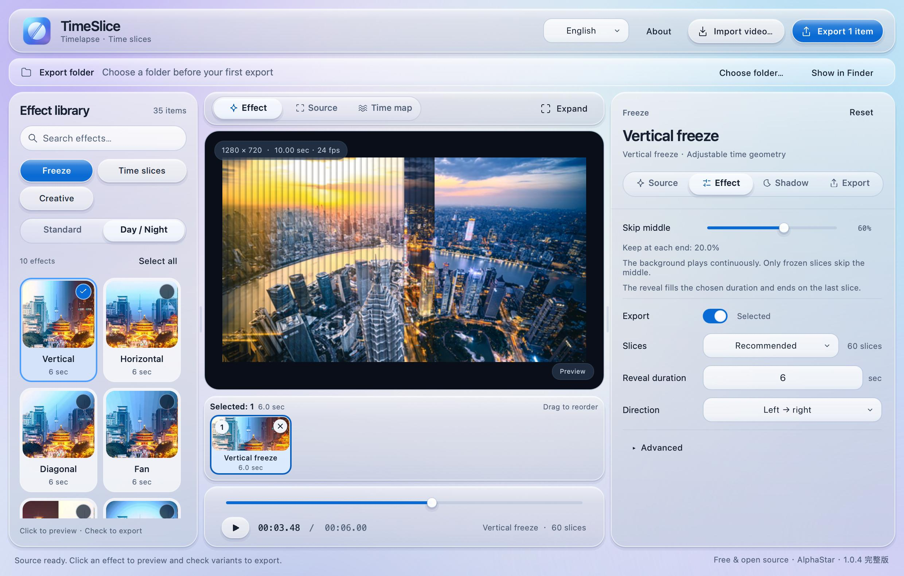
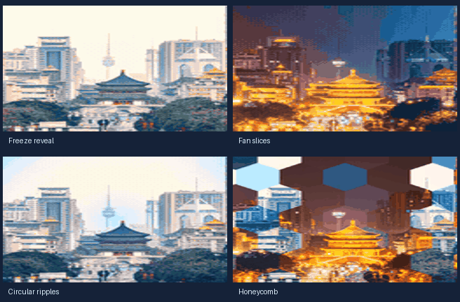

# 时刃 · TimeSlice

[简体中文](README.md) · [Build guide](docs/开发指南.md) · [Changelog](CHANGELOG.md)

**One timelapse. More ways to unfold time.** A free, open-source timelapse slicing tool by AlphaStar for macOS, Windows and Android.

Import a video, choose an effect, adjust the slices and shadows, then export each selected effect in queue order. Processing stays on your device. Premiere Pro or After Effects is not required.



## Features

- **46 effects:** freeze reveals, basic slices, moving ripples and creative variations, grouped by geometry and motion.
- **Adjustable slices:** count, direction, starting angle, timing, one-sided shadows and day/night separation. Straight strips can reach one slice per output pixel.
- **Grayscale time maps:** control which source time appears in each part of the image.
- **Ordered exports:** select effects, drag to reorder and export separate videos.
- **Video finishing:** the full desktop version includes fixed-view stabilization, three deflicker levels, start/end color grading and HSL. Prepared source caches are reused during export.
- **Separate Lite edition:** a smaller workflow focused on importing video, adjusting slices and exporting.



## Downloads

The current release candidates are **test builds**. Once published, choose an archive from this repository's **Releases** section. Application binaries are kept out of Git history.

| Platform | Version | Requirements |
| --- | --- | --- |
| macOS full | 1.0.7 | Apple Silicon, macOS14+ |
| macOS Lite | 1.0.7-lite.1 | Apple Silicon, macOS14+ |
| Windows | 1.0.7-preview.1 | Windows10 22H2 / 11, x64 |
| Android | 1.0.5-hdr-preview.1 | Android10+ for 8-bit; Android13+ with P010 for 10-bit/HDR |

Extract the full archive before launching. Import a video, select an effect and choose an output folder before your first export. Android supports the gallery or a chosen folder.

The macOS test builds are locally signed and have not been notarized by Apple. Windows requires the complete extracted folder, including its runtime. Android updates require the same signing key as the installed build.

Input is a timelapse video. Output supports H.264 8-bit SDR and HEVC Main10 SDR/PQ/HLG in MP4. Temporal sampling blends adjacent frames; optical-flow interpolation is not implemented. Full-detail 4K processing needs substantial temporary disk space. Mobile exports warn about demanding resolution, frame-rate and bitrate settings.

## Build and test

Use Python3.11. Install Xcode Command Line Tools on macOS, or Visual Studio C++ Build Tools on Windows and use Developer PowerShell.

```sh
python -m pip install -r requirements-dev.txt
python tools/build_desktop.py --run
python tools/check_desktop.py --cpu-only
python tools/golden.py
```

With Make, run `make check test PYTHON=python`. For actual GPU comparisons, run `python tools/check_desktop.py --gpu` on supported hardware. Linux is used for CPU verification only and is not a supported application distribution.

See the [build guide](docs/开发指南.md) for Lite, Android, compact FFmpeg/OpenCV builds and benchmarks. The GitHub workflows run after upload; local validation is not a GitHub Actions result.

## Export quality

Bitrate follows the actual output resolution and frame rate, or accepts a custom target from 1 to 500 Mbps. Smooth gradients is enabled for export by default. Output supports 8-bit SDR H.264 and HEVC Main10 SDR/PQ/HLG. It cannot restore color levels already missing in the source.

## Repository layout

- `app/`: shared time fields, CPU/GPU engine, media and base controllers.
- `mac-5.0-redesign/`: the single maintained desktop UI, finishing and export implementation shared by Mac and Windows. The directory name is retained for compatibility.
- `lite/`: lightweight desktop UI and build configuration.
- `mobile/android/`, `mobile/android-core/`, `mobile/shared/`: Android UI, JNI and shader generation.
- `tools/`, `tests/`: builds, 92 golden frames, numerical/UI checks and benchmarks.
- `docs/`, `LICENSES/`: guides, validation records and notices.

Platform versions are independent. The root `release.json` records the shared specification baseline, not the latest application version. Build caches, SDKs, signing keys, private footage and historical work records are excluded from the public source tree.

## Contributing and license

Read [CONTRIBUTING.md](CONTRIBUTING.md) for bug reports and pull requests, or [SECURITY.md](SECURITY.md) for security reports. Validation covers specific Mac, Windows and Redmi devices; see the [matrix](docs/验证矩阵.md) for its limits.

**Author: AlphaStar. License: AGPL-3.0-only.** [Full license](LICENSE) · [Third-party components](THIRD_PARTY.md) · [Media and fonts](NOTICE.md)

The official software is free. AGPL permits commercial use and paid redistribution while imposing source, modification and network-interaction obligations. Your input videos and creative outputs do not automatically become AGPL works. The software is provided as-is; keep backups and inspect your results.
