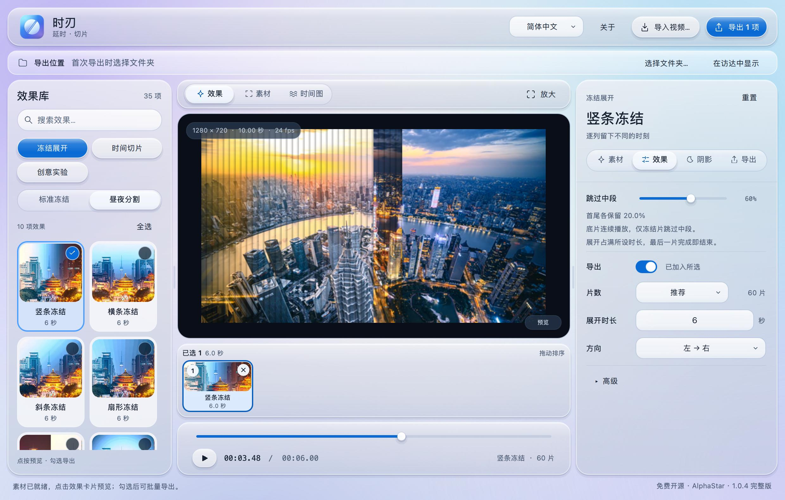
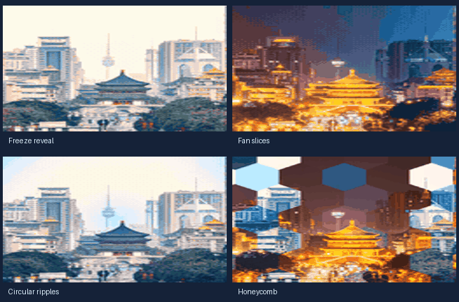

# 时刃 · TimeSlice

[English](README.en.md) · [使用指南](docs/使用指南.md) · [开发指南](docs/开发指南.md) · [更新记录](CHANGELOG.md)

**一段延时，切出更多时间。** AlphaStar制作的免费开源延时切片工具，支持Mac、Windows和Android。

导入一段延时视频，选择效果、调整切片和阴影，再按队列分别导出。软件在本机处理视频，无需打开PR或AE。



## 能做什么

- **46种效果**：冻结展开、基础切片、流动波纹和创意效果；相近形状按运动方式分组选择。
- **可调切片**：数量、方向、起始角度、展开节奏、单侧渐变阴影和昼夜分割。条形支持按输出尺寸逐像素切分。
- **黑白时间图**：导入灰度图，控制画面不同位置对应的源视频时刻。
- **可视化队列**：选择多个效果，拖动排序，分别输出视频。
- **视频处理**：完整版提供固定机位稳定、三级去闪、首尾调色/HSL；已处理素材缓存可供导出复用。
- **10位与HDR**：真正RGB10缓存、浮点合成和Main10输出；支持10位SDR、PQ和HLG，HDR预览以SDR映射显示。
- **导出画质**：按实际输出尺寸/帧率推荐码率，也可自定义1–500 Mbps；导出默认开启平滑渐变。
- **独立Lite版**：专注视频导入、切片与输出，界面和依赖更少。



## 下载与使用

当前准备发布的是**测试构建**。仓库发布后，在右侧 **Releases** 选择平台压缩包；安装包不放入Git源码历史。

| 平台 | 当前版本 | 要求 |
| --- | --- | --- |
| Mac完整版 | 1.0.6 | Apple Silicon、macOS14+ |
| Mac Lite | 1.0.6-lite.1 | Apple Silicon、macOS14+ |
| Windows | 1.0.6-hdr-preview.1 | Windows10 22H2 / 11，x64 |
| Android | 1.0.5-hdr-preview.1 | 8位Android10+；10位/HDR需Android13+及P010支持 |

完整解压后启动软件，导入视频，选择效果。**首次导出时自行选择保存目录**。Android可保存到相册或自选目录。

Mac测试构建已本地签名，尚未Apple公证；首次打开方法见[使用指南](docs/使用指南.md)。Windows须完整解压，不能只取出exe。Android安装包可覆盖同签名旧版。

当前输入为延时视频，输出支持H.264 8位SDR及HEVC Main10 SDR/PQ/HLG MP4。时间采样使用相邻帧混合，尚未接入光流插帧。4K完整采样需要较多工作盘空间；手机高规格输出会提示负载、耗电与发热。支持上限和缓存限制见使用指南。

## 从源码运行

使用Python3.11。Mac安装Xcode Command Line Tools；Windows安装Visual Studio C++ Build Tools，并在Developer PowerShell执行。

```sh
python -m pip install -r requirements-dev.txt
python tools/build_desktop.py --run
```

核心检查与标准帧回归：

```sh
make check test PYTHON=python
```

Windows无Make时，运行`python tools/check_desktop.py --cpu-only`和`python tools/golden.py`。有真实GPU时可运行`python tools/check_desktop.py --gpu`；Linux仅作为CPU数值验证环境，不是本项目发行平台。

桌面/Lite/Android打包、精简视频工具构建和性能基准见[开发指南](docs/开发指南.md)。CI配置会在推送后执行；本地已有通过结果不代表GitHub Actions已经运行。

## 源码结构

| 目录 | 内容 |
| --- | --- |
| `app/` | 共享时间场、CPU/GPU引擎、媒体与基础控制器 |
| `mac-5.0-redesign/` | Mac/Windows共用的当前UI、视频处理与导出；保留目录名以兼容路径 |
| `lite/` | 桌面轻量界面与独立构建配置 |
| `mobile/android/`、`android-core/`、`shared/` | 安卓界面、JNI和着色器生成入口 |
| `tools/`、`tests/` | 构建、92标准帧、数值/界面和性能检查 |
| `docs/`、`LICENSES/` | 使用、维护、验证及第三方声明 |

各平台发行版本独立维护；根`release.json`保存共享规格基线，实际版本见各平台的release元数据。`build/`、`dist/`、SDK、签名密钥、私人原片和历史工作记录不属于公开源码。

## 验证与参与

本机Mac、授权Windows实机和一台红米已有验证记录；覆盖范围见[验证矩阵](docs/验证矩阵.md)，不泛化到所有CPU、显卡和手机。预览效果、原始像素对照、完整解码与性能测量分别记录。

欢迎提交[问题和建议](CONTRIBUTING.md)。安全问题见[SECURITY.md](SECURITY.md)。

## 免费与许可

**作者：AlphaStar。自有代码采用AGPL-3.0-only。** [许可全文](LICENSE) · [第三方组件](THIRD_PARTY.md) · [素材和字体](NOTICE.md)

软件免费提供。AGPL允许商业使用和收费分发，同时要求遵守对应源码、修改版和网络交互等义务。使用者的视频素材和创作输出不会自动变为AGPL作品。软件按原样提供，请备份素材并检查输出。
